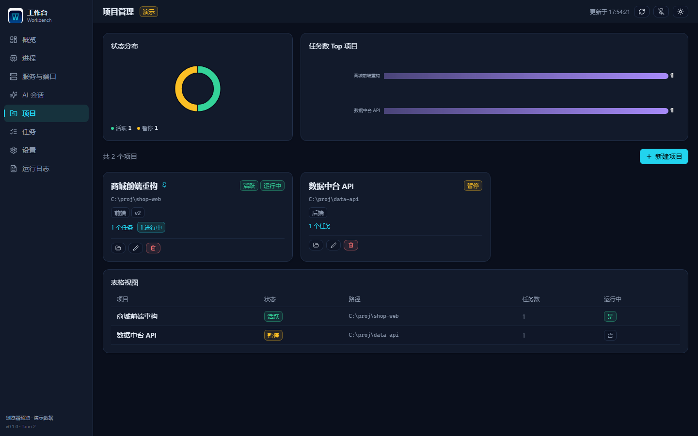
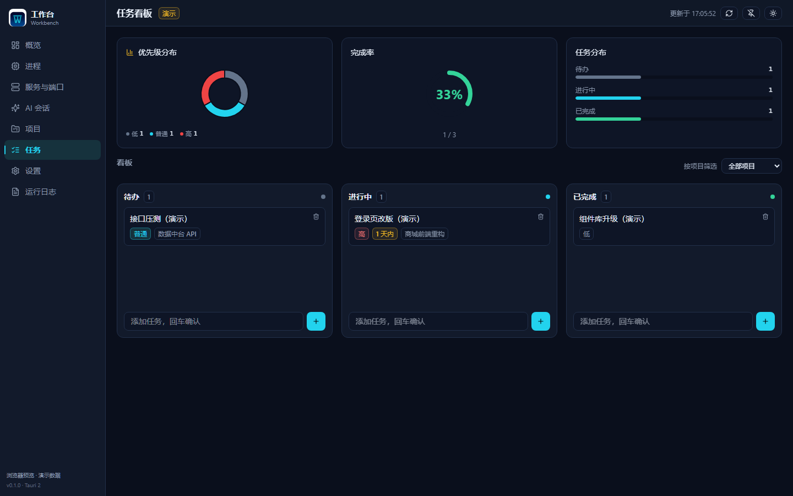
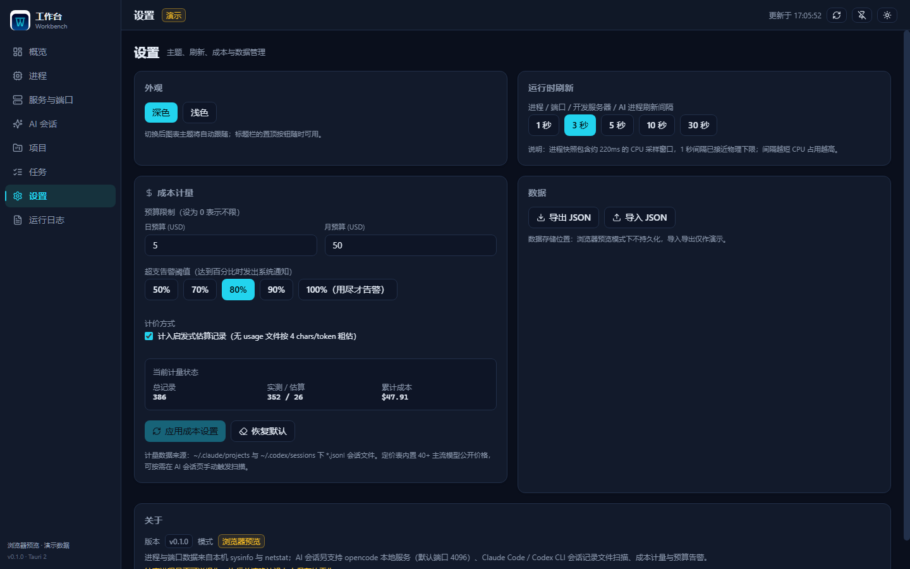
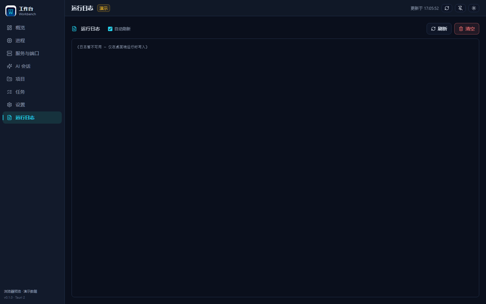

# Workbench

[English](README.md) | [简体中文](README.zh-CN.md) | **日本語**

> Tauri 2 デスクトップアプリ · ローカル運用ダッシュボード · AI セッションコスト計測

[](https://github.com/X33834/workbench/actions/workflows/ci.yml)
[](https://github.com/X33834/workbench/releases/latest)
[](LICENSE)
[](#システム要件)
[](https://tauri.app/)
[](https://react.dev/)

ローカルファースト・プライバシー重視のデスクトップ運用ワークベンチ。プロセス・
ポート・開発サーバー・AI コーディングセッションのトークンコストを 1 画面で可視化
します。データは端末内にのみ保存、ダーク / ライト両テーマ対応。UI は
**English / 简体中文 / 日本語** を切り替えられます。

**現時点では Windows のみで開発・パッケージング**（ポート取得は `netstat -ano`、
インストーラーは NSIS）。macOS / Linux は未検証・未対応です。

**🌐 プロジェクトページ** —— 各ミラーがそれぞれのランディングページを持っています
（下記ミラー表参照）。各ページのリンクは自動的にそのミラー自身のリポジトリと
Release を指します。

---

## ダウンロード

開発環境の構築は不要です（Windows 10 / 11 x64）。以下の各 GitHub ミラーは
**それぞれ独自の Release** で同じインストーラーを公開しています:

| 方法 | ファイル | 説明 |
|------|----------|------|
| **推奨** | `Workbench_<version>_x64-setup.exe`（Releases → latest） | NSIS インストーラー、約 4 MB |
| ポータブル | `workbench.exe`（Releases → latest） | 単一ファイル、レジストリ書き込みなし |

> インストーラーはコード署名されていないため、Windows SmartScreen が
> 「不明な発行元」の警告を表示することがあります。**詳細情報 → 実行** で
> 問題ありません。署名証明書に費用がかかるためであり、ファイルが危険という
> ことではありません。

### ミラー

コードは 5 プラットフォームで同一。各々が CI を回し、対応プラットフォームは
それぞれ Release を公開します:

| プラットフォーム | リポジトリ | ランディングページ |
|------------------|------------|--------------------|
| GitHub | [X33834/workbench](https://github.com/X33834/workbench) | [x33834.github.io/workbench](https://x33834.github.io/workbench/) |
| GitHub | [badhope/workbench](https://github.com/badhope/workbench) | [badhope.github.io/workbench](https://badhope.github.io/workbench/) |
| GitHub | [Morningstar202604/workbench](https://github.com/Morningstar202604/workbench) | [morningstar202604.github.io/workbench](https://morningstar202604.github.io/workbench/) |
| Gitee | [badhope/workbench](https://gitee.com/badhope/workbench) | —（ダウンロードは Release ページ） |
| GitCode | [badhope/workbench](https://gitcode.com/badhope/workbench) | —（ダウンロードは Release ページ） |

---

## スクリーンショット

> 以下の画像は**ブラウザデモモード**（`npm run preview`）で撮影したものです:
> Tauri 環境以外では `src/lib/demo.ts` のデモデータを注入するため、パスや
> ホスト名はすべてプレースホルダーで、実機データは含まれません。

| 概要 | プロセス |
|------|----------|
|  |  |
| CPU / メモリ傾向、ディスク、プロセス分類 | 全プロセス snapshot、仮想スクロール、強制終了の確認 |

| サーバー & ポート | AI セッション & コスト |
|-------------------|------------------------|
|  |  |
| netstat 解析、開発フレームワーク判定 | セッション一覧、トークン計測、予算アラート |

| プロジェクト | タスク |
|--------------|--------|
|  |  |
| ローカルプロジェクト、Git ブランチ検出 | ドラッグ＆ドロップのカンバン |

| 設定 | ログ |
|------|------|
|  |  |
| テーマ、更新間隔、予算、インポート/エクスポート | 内蔵ログビューア、末尾読み取り |

スクリーンショットは自分で再生成できます: `npm run build` → `npm run preview`
→ ヘッドレス Chrome を `--remote-debugging-port=9222` で起動 →
`node scripts/shoot_docs.mjs`。スクリプトはデモモードであることを検証し、
失敗時は撮影を拒否するため、実データがリポジトリに入ることはありません。

## 機能

| モジュール | 機能 |
|------------|------|
| 🖥 **概要** | CPU / メモリの推移グラフ、ディスク使用率ドーナツ、プロセス分類統計 |
| ⚙ **プロセス** | 全プロセス snapshot、CPU / メモリソート、仮想スクロール（視覚領域のみ描画）、強制終了の二重確認、AI エージェント検出 |
| 🌐 **サーバー & ポート** | netstat によるリッスン検出、開発フレームワーク判定（Vite / Next / Django…） |
| 🤖 **AI セッション** | opencode オンラインセッション、ローカル Claude / Codex セッションプレビュー |
| 💰 **コスト計測** | トークン消費、日別推移、予算アラート、Anthropic キャッシュの課金 |
| 📁 **プロジェクト** | ローカルプロジェクト管理、Git ブランチ自動検出 |
| ✅ **タスク** | カンバンボード（ドラッグで状態変更） |
| ⚙ **設定** | テーマ / 更新間隔、予算しきい値、JSON インポート & エクスポート |
| 📋 **ログ** | 内蔵ビューア、自動更新、末尾読み取り |

## コスト計測

- **3 段階の信頼度**: measured（API 報告の usage）→ estimated（文字数ヒューリスティック）→ zero_pricing
- **40+ モデルの価格を内蔵**。`pricing_overrides.json` による上書きは現時点で
  **読み取り専用**（手動配置のみ、UI エディタは未提供）
- **Anthropic キャッシュの意味論**: `input_tokens` にキャッシュは含まれず、
  `cache_read_input_tokens` は 0.1 倍、`cache_creation_input_tokens` は 1.25 倍で
  別途計上
- **日付帰属**: measured / estimated とも JSONL 行単位の `timestamp` で日別集計
  （欠損時は前日 / ファイル mtime にフォールバック）。セッション追記は最新日だけを
  更新し、過去の推移は書き換わりません
- **未知モデルは無課金**: 特定できないモデルは `unknown` として `zero_pricing` 扱い、
  でっち上げの単価は付けません
- **冪等**: セッションファイルごとに最新スナップショットのみ保持（`file_path`
  単位で丸ごと置換）。再スキャンで古い行が積み重なることはありません
- **推定はオフ可**: 設定の「推定レコードを含める」トグルで概要 / 推移 / モデル別が
  即時更新されます
- **予算アラート**: システム通知。重複通知は抑止
- **スキャン範囲**: `~/.claude/projects` と `~/.codex/sessions` 配下の全セッション
  ファイル（UI プレビューは最新 10 件のみ表示）

## デスクトップ動作

- ウィンドウを閉じるとトレイに格納。トレイ左クリックで表示切替、トレイメニューの
  終了で実際にプロセスを終了
- グローバルホットキー `Ctrl+Shift+W` で表示 / 非表示（競合時は警告に劣化し、
  起動は妨げません）
- ログは起動単位でローテーション（5 MB 超で `workbench.log.1` に退避）。
  ログページは末尾から必要分だけ読み取ります
- PID 0/4 と重要システムプロセス（csrss / lsass / services 等）の強制終了は拒否

## はじめに

### システム要件

| 項目 | 要件 |
|------|------|
| OS | Windows 10 / 11（x64）—— 検証済みはこのプラットフォームのみ |
| ランタイム | WebView2 Runtime（Windows 11 は同梱。最近の Windows 10 でも大半は同梱） |
| ディスク | インストール後約 35 MB。ポータブル版は単一ファイル約 15 MB |
| 権限 | 管理者権限は不要。プロセス終了には対象と同等以上の権限が必要 |
| ネットワーク | 不要。AI セッションページを開いたときにローカル opencode サービスを探知するだけ |

### Release からインストール（推奨）

1. [最新リリース](https://github.com/X33834/workbench/releases/latest) から
   `Workbench_<version>_x64-setup.exe` を入手
2. SmartScreen が出たら **詳細情報 → 実行**
3. スタートメニューから「Workbench」を起動

### ソースからビルド

必要環境: [Node.js](https://nodejs.org/) ≥ 20、
[Rust](https://www.rust-lang.org/tools/install) ≥ 1.77、WebView2。

```bash
npm install
```

### IPC 契約型の生成

IPC をまたぐ型は `src/types.ts` に手書きせず、Rust 構造体から生成します:

```bash
cd src-tauri
cargo test --test export_bindings   # src/generated/*.ts を再生成
```

`src/types.ts` は re-export のみ、`src/generated/` がコミット済みの契約
スナップショットです。Rust 構造体を変更したら必ず上記を再実行してください。
さもないと CI のドリフトゲートに弾かれます。

### 開発

```bash
npm run tauri dev      # デスクトップ開発モード（ホットリロード付き）
npm run dev            # フロントエンドのみ。ブラウザデモモード。Rust 不要
```

### 本番ビルド

```bash
npm run tauri build
```

成果物は `src-tauri/target/release/bundle/` に出力されます。

## 技術スタック

| レイヤー | 採用技術 |
|----------|----------|
| ランタイム | Tauri 2（Rust + OS WebView） |
| フロントエンド | React 19 + TypeScript（strict）+ Vite 8 |
| 状態管理 | Zustand 5（persist） |
| スタイル | Tailwind CSS 4 + 二テーマ CSS 変数 |
| グラフ | ECharts 6（必要分のみ取り込み、ダーク/ライト両テーマ登録） |
| 仮想スクロール | @tanstack/react-virtual 3（展開行の可変高さ対応） |
| 購読 | Zustand 5 `useShallow` セレクタ + `memo` ページコンポーネント |
| IPC | Tauri IPC + spawn_blocking |
| 契約 | ts-rs 12 が Rust 構造体から `src/generated/*.ts` を生成、CI がドリフト検証 |
| プロセス取得 | sysinfo |
| ポート解析 | netstat パーサー（POSIX / Windows 両方言） |
| 多言語 | 英語デフォルト、簡体中文 / 日本語に切替可 |
| 品質ゲート | ESLint 10 + Prettier 3 + vitest 5 + clippy `-D warnings` |

## プロジェクト構成

```
workbench/
├── src/                    # フロントエンド
│   ├── pages/              # 8 つの機能ページ（遅延読み込み）
│   ├── lib/                # store / api / echarts / chartTheme / i18n / util
│   ├── generated/          # ts-rs 生成の IPC 契約型（手動編集禁止）
│   ├── ui.tsx              # 共有コンポーネント
│   ├── types.ts            # 型の re-export とフロント固有の型
│   ├── App.tsx             # アプリシェル
│   └── styles/global.css   # グローバルスタイルとテーマ変数
├── src-tauri/              # Rust バックエンド
│   ├── capabilities/       # Tauri 権限セット（最小構成）
│   ├── icons/              # アプリアイコン（scripts/make_icons.py が生成）
│   ├── src/
│   │   ├── commands.rs     # IPC コマンド層
│   │   ├── procs.rs        # プロセス snapshot と終了
│   │   ├── ports.rs        # netstat 解析
│   │   ├── devserver.rs    # 開発フレームワーク判定
│   │   ├── ai.rs           # AI セッション取得
│   │   ├── pricing.rs      # モデル価格マッチング
│   │   ├── session_meter.rs# JSONL トークンコスト解析
│   │   ├── cost_store.rs   # コストデータ永続化
│   │   ├── ipc_guard.rs    # IPC 引数ホワイトリスト
│   │   └── lib.rs          # Tauri 起動エントリ
│   └── tests/              # IPC 契約エクスポートテスト
├── docs/                   # GitHub Pages ランディングページ + スクリーンショット
├── scripts/                # アイコン生成・スクリーンショット補助
└── .github/workflows/      # CI / Release / Pages
```

## 開発と品質

```bash
npm run format:check       # Prettier
npm run lint               # ESLint（警告ゼロ）
npm run test               # フロントエンド単体テスト（vitest、48 ケース）
npm run coverage           # カバレッジ
npm run build              # tsc + vite build

cd src-tauri
cargo test                 # バックエンドテスト + IPC 契約エクスポート
cargo clippy --all-targets -- -D warnings   # 警告ゼロゲート
```

純粋な Rust ロジック（netstat 解析、フレームワーク判定、価格マッチング、トークン
抽出、JSON 永続化、IPC ガード）には `#[cfg(test)]` の単体テストがあり、フロント
エンドは vitest（util / store / 共有コンポーネント / エラー境界）でカバーしてい
ます。CI はフォーマット・Lint・型チェック・ビルド・両側のテスト・clippy 警告ゼロ
に加え、`src/generated/` と Rust 構造体の一致も検証します。

## FAQ

<details>
<summary>コスト計測はどう計算されますか？正確ですか？</summary>

ローカルの Claude Code / Codex セッション JSONL 内の `usage` フィールドを解析し、
内蔵の 40+ モデル価格で計算します。信頼度は 3 段階:

- **measured** —— API が報告した実際の usage。最も正確
- **estimated** —— usage なし。文字数ヒューリスティックで推定（設定でオフ可）
- **zero_pricing** —— モデルを特定できず、無課金として記録（単価の捏造はしない）

Anthropic のキャッシュトークンは公式の意味論に従います（読み 0.1 倍、
書き 1.25 倍）。
</details>

<details>
<summary>データをクラウドに送信しますか？</summary>

いいえ。プロジェクト・タスク・コスト台帳・ログはすべてローカルの app data
ディレクトリに書き込まれます。アプリがローカルで行うのは 2 つだけ: `netstat`
でポートを確認、ローカルのセッションファイルでコストを計算。唯一の任意の通信は
ローカル opencode サービス（既定ポート 4096）の探知で、失敗しても「未検出」と
表示されるだけで他機能への影響はありません。
</details>

<details>
<summary>プロセスを殺してもシステムを壊しませんか？</summary>

いいえ。PID 0/4 と重要システムプロセス（csrss、lsass、services 等）はバックエンド
が拒否します。フロントエンドは事前に確認を求め、終了前に対象の同一性を再検証して
PID 再利用による誤爆を防ぎます。
</details>

<details>
<summary>閉じたウィンドウはどこへ？終了方法は？</summary>

トレイへの格納は意図的な設計です（常駐監視のため）。トレイアイコンを右クリックし
「終了」を選ぶと実際に終了します。<code>Ctrl+Shift+W</code> でいつでも表示 /
非表示を切り替えられます。
</details>

<details>
<summary>Windows が「不明な発行元」と警告します</summary>

インストーラーはコード署名されていません（証明書に費用がかかるため）。
**詳細情報 → 実行** で続行するか、ポータブル版 exe をお使いください。
</details>

## ロードマップ

- [x] プロセス / ポート / 開発サーバーのリアルタイム監視
- [x] AI セッションのコスト計測と予算アラート
- [x] プロジェクト & タスクカンバン
- [x] ダーク / ライトテーマ、ログビューア
- [x] 多言語 UI（English / 简体中文 / 日本語）
- [ ] クロスプラットフォーム対応（macOS / Linux の取得とパッケージング）
- [ ] インストーラーのコード署名
- [ ] `pricing_overrides.json` の UI エディタ
- [ ] コスト台帳のシャーディング（10 万件規模）
- [ ] ページ単位の E2E テスト

## 既知の制限

- Windows でのみ検証: ポート取得は `cmd /c netstat -ano` 固定で、`ports.rs` の
  POSIX 分岐は現在実行されません
- フロントエンドの操作パスは手動検証が中心: vitest は util / store / 共有
  コンポーネント / エラー境界をカバーしますが、8 ページの E2E テストはありません
- コスト台帳は単一の `cost_data.json`（書き込みは直列化）。記録が非常に多い場合は
  全読み書きが重くなります
- `pricing_overrides.json` は読み取り専用で、書き込み経路はありません
- インストーラーは未署名のため、初回起動時に SmartScreen が出ることがあります
- トレイメニューの文言は現在中国語のみ（フロントエンド UI は完全に三言語対応）

## データの保存先

| ファイル | 用途 | 場所 |
|----------|------|------|
| `data.json` | プロジェクトとタスク | app data dir |
| `cost_data.json` | コスト記録 + 価格設定 | app data dir |
| `pricing_overrides.json` | ユーザー定義のモデル価格（読み取り専用・手動配置） | app data dir |
| `workbench.log` | 実行ログ | app data dir |
| `*.corrupt-<timestamp>` | 解析失敗時の元データバックアップ（次回保存で上書きされない） | app data dir |

Windows の app data dir は `%APPDATA%\com.workbench.desktop` です。

## コントリビュート

- 開発フローと規約: [CONTRIBUTING.md](CONTRIBUTING.md)
- 脆弱性の報告: 秘密チャネル [SECURITY.md](SECURITY.md)
- 行動規範: [CODE_OF_CONDUCT.md](CODE_OF_CONDUCT.md)
- 変更履歴: [CHANGELOG.md](CHANGELOG.md)

## ライセンス

[MIT](LICENSE) © 2026 x1882
