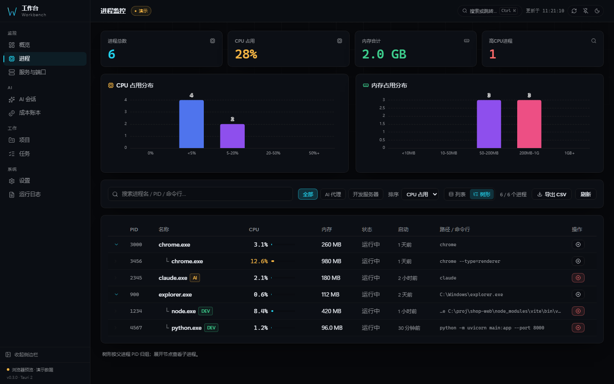
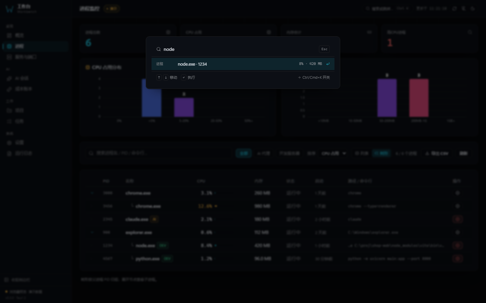

# Workbench

**English** | [简体中文](README.zh-CN.md) | [日本語](README.ja.md)

[](https://github.com/X33834/workbench/releases/latest)
[](LICENSE)
[](docs/ARCHITECTURE.md#system-requirements)
[](https://github.com/X33834/workbench/actions/workflows/ci.yml)


**See the port. Find the process. Know the cost.**

A local-first desktop workbench for people who run services and AI coding
agents on their own machine. One window shows every process, listening port,
dev server, project, task — and what your Claude Code / Codex sessions actually
cost. Data never leaves the device, and there is no account, no cloud, no model
to configure.

## What makes it different

| | |
|---|---|
| **Port → process → cost** | A listening port links to the process that owns it, and a process shows every port it holds. Session files connect the same machine's work to real spend. No other local tool joins those three views. |
| **Understands dev servers** | Not just "port open": Vite, Next, Nuxt, Django, uvicorn, Rails and 30+ more are recognised from the command line, with a confidence level. |
| **Keyboard-first** | Ctrl/Cmd+K searches every page, process, port, project and task. Flat table or parent/child tree. Everything reachable without the mouse. |
| **Trustworthy by construction** | Protected system processes are rejected in Rust, the target identity is re-checked right before a kill, UAC elevation is opt-in per action, and every report states what it verified. |
| **Local-first, honestly** | SQLite ledger on your disk, CSP locked to `self`, no telemetry. The only outbound request is the optional probe of a local opencode server. |

## Screenshots

| Overview | Processes |
|----------|-----------|
|  |  |
| CPU / memory trends, disks, process groups | Full snapshot, virtual scrolling, CSV export |

| Process tree | Command palette |
|--------------|-----------------|
|  |  |
| Parent/child grouping with per-process ports | Ctrl/Cmd+K across pages, processes, ports, projects, tasks |

| Servers & ports | AI sessions |
|-----------------|--------------|
|  |  |
| netstat / ss parsing, dev-framework tags | Session files, live sessions, tool mix |

| Cost ledger | Tasks |
|-------------|-------|
|  |  |
| Budget progress, trend, model split | Drag-and-drop kanban |

### 30-second tour

[](docs/screenshots/workbench-demo.mp4)

Recorded from the real UI in browser demo mode (no real host, path or account
data appears in it). [Download the MP4](docs/screenshots/workbench-demo.mp4).

## Features

| Feature | What you get |
|---------|--------------|
| **Monitoring** | Live processes, listening ports (`netstat` on Windows, `ss -tulpn` on Linux with a netstat fallback) and dev-server detection with framework + confidence |
| **Process tree** | Flat table or parent/child tree from `parent_pid`; orphan and cycle-safe, virtual scrolling, per-row detail with the process's own listening ports, CSV export |
| **Command palette** | Ctrl/Cmd+K fuzzy search over pages, processes, ports, projects and tasks; keyboard navigation with ↑ ↓ ↵ Esc |
| **Elevated kill** | "End as administrator" retry after a normal kill fails — triggers the OS UAC prompt; protected system processes are rejected by the backend before any prompt appears |
| **AI cost metering** | Token costs of local Claude / Codex sessions in a SQLite ledger — no model, no API key, nothing leaves your machine |
| **Pricing editor** | 40+ built-in model prices; edit / add / reset overrides from the UI |
| **Backup & restore** | Timestamped snapshots with one-click rollback and integrity checks (`VACUUM INTO` + `PRAGMA integrity_check`) |
| **Start at login** | Real OS registration (registry / autostart entry), toggle reads back from the OS |
| **Environment check** | Per-item ok / warn / fail report for platform, data directory, cost DB, session folders and port tools, with a copyable summary |
| **CLI mode** | The same binary answers `workbench ps`, `workbench ports` and `workbench diag` (add `--json`) — read-only, scriptable, no window |
| **Visual system** | 7 overview layouts × 8 themes × 3 shells, draggable & hideable widgets with per-widget widths, theme editor with share links |
| **Trilingual UI** | 简体中文 (default) / English / 日本語 |
| **Cross-platform** | Windows (NSIS + portable exe), Linux (`.deb`), macOS (`.app`, CI-built unsigned) |

## Download

**v0.3.0** — grab the installer for your platform:

| Platform | File |
|----------|------|
| Windows 10/11 x64 | `Workbench_0.3.0_x64-setup.exe` (NSIS, ~5 MB) — attached to the GitHub / Gitee / GitCode release |
| Linux x64 | no published asset yet — `npm run tauri build -- --bundles deb`, or take the `linux-deb` CI artifact |
| macOS | no published asset yet — `npm run tauri build -- --bundles app`, or take the `macos-app` CI artifact (unsigned: right-click → Open) |

> Not code-signed, so Windows SmartScreen may show an "Unknown publisher"
> warning — choose **More info → Run anyway**. macOS builds are unsigned too;
> right-click the app and choose Open the first time. Certificates cost money;
> neither file is unsafe.

Pick any mirror — identical code, each publishes its own releases:

| Mirror | Releases |
|--------|----------|
| GitHub | [github.com/X33834/workbench/releases](https://github.com/X33834/workbench/releases) |
| Gitee | [gitee.com/badhope/workbench/releases](https://gitee.com/badhope/workbench/releases) |
| GitCode | [gitcode.com/badhope/workbench/releases](https://gitcode.com/badhope/workbench/releases) |

## Build

Requires Node.js ≥ 20 and Rust ≥ 1.90:

```bash
npm install
npm run tauri dev      # desktop dev mode (hot reload)
npm run tauri build    # installers → src-tauri/target/release/bundle/
```

Local CI mirror (same steps as `.github/workflows/ci.yml`):

```bash
node scripts/ci-local.mjs          # typecheck → lint → format → unit → build → Playwright → cargo
node scripts/ci-local.mjs --fast   # skip the visual-regression pass
```

Command line (same executable, no window):

```bash
workbench ps            # every process: pid, name, cpu%, memory, parent, status
workbench ports         # listening TCP/UDP ports with the owning PID
workbench diag          # environment self-check
workbench ports --json  # machine-readable output for scripts
```

Tech stack, project structure, FAQ, roadmap, screenshots and everything else
live in the [architecture & reference doc](docs/ARCHITECTURE.md)
([简体中文](docs/ARCHITECTURE.zh-CN.md) / [日本語](docs/ARCHITECTURE.ja.md)).
How this compares with Mission Center, System Informer, btop++, Glances,
ccusage and friends: [docs/COMPARISON.md](docs/COMPARISON.md).

## Contributing & License

- Contribution workflow: [CONTRIBUTING.md](CONTRIBUTING.md) · Security:
  [SECURITY.md](SECURITY.md) · Conduct: [CODE_OF_CONDUCT.md](CODE_OF_CONDUCT.md) ·
  Changelog: [CHANGELOG.md](CHANGELOG.md)
- [MIT](LICENSE) © 2026 x1882
